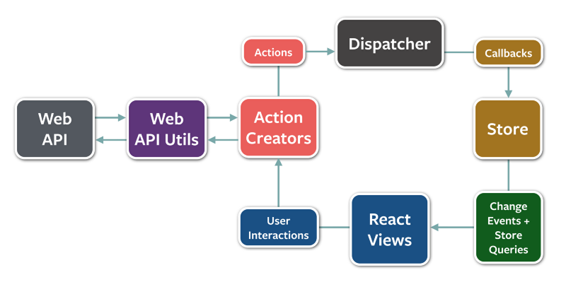

ℹ️ This article is authentic, fully organic, handcrafted by a human mind. No AI was harmed or used in generating the ideas for content and title.

Before diving into concepts, let’s first look at some code and see how simple and elegant Zustand can be.

---

1. `theme.store.ts`

```typescript
import { create } from "zustand";

type ThemeStore = {
  theme: "light" | "dark";
  toggleTheme: () => void;
};

export const useThemeStore = create<ThemeStore>((set) => ({
  theme: "light",
  toggleTheme: () =>
    set((state) => ({
      theme: state.theme === "light" ? "dark" : "light",
    })),
}));
```

2. `App.tsx`

```typescript
import { useThemeStore } from "./theme.store";

export default function App() {
  const theme = useThemeStore((state) => state.theme);
  const toggleTheme = useThemeStore((state) => state.toggleTheme);

  return (
    <div>
      <p>Current theme: {theme}</p>
      <button onClick={toggleTheme}>Toggle Theme</button>
    </div>
  );
}
```

---

### What is Zustand?

Official docs says:

> A small, fast, and scalable bearbones state-management solution using simplified flux principles. Has a comfy API based on hooks, isn’t boilerplatey or opinionated.

- Zustand is one of my favourite state management library for react.
- Currently it is one most popular and the simplest state manager.
- It was written by the same person who wrote other state manager [Jotai](https://madanbajgai.com.np/blog/dead-simple-yet-powerful-state-manager-for-redux-haters/) (checkout the blog).
- While Jotai follows an atomic pattern, Zustand follows the **[flux pattern](#what-is-flux-pattern)** like Redux, but with much less complexity.
- It is very simple to setup
- Its minimal. No boilerplate.
- It is really fast.

---

### The problems with the Context API

React’s Context API helps avoid prop drilling, but it comes with a big drawback:

- Whenever context changes, **all consumers re-render**, even if they don’t depend on the changed value.
- This makes it inefficient for large applications.

Zustand fixes this:

- It is designed for minimal re-renders.
- Components only re-render if the **specific state they consume** changes.
- Stores can be split into smaller, modular states (instead of one giant context).
- Much more scalable for complex apps.

---

### What is flux pattern?

- Flux was introduced by Facebook.
- It is a architectural design pattern for managing state.
- The core idea is **unidirectional data flow** - data flows in a single direction, making complex state management simpler, easier to understand, and easier to debug.
- The following familiar image would explain the concept of flux pattern. If you have not seen this picture, congratulations, don't bother.



---

### Other features

1. Dev tools
2. Persistance
3. Immer middleware
4. Slices pattern
5. Async friendly
6. Great typescript suppert

---

### Persistence Example

Zustand makes it easy to persist state to localStorage (or sessionStorage):

**`theme.store.ts`**

```typescript
import { create } from "zustand";
import { persist, createJSONStorage } from "zustand/middleware";

type ThemeStore = {
  theme: "light" | "dark";
  toggleTheme: () => void;
};

export const useThemeStore = create<ThemeStore>()(
  persist(
    (set) => ({
      theme: "light",
      toggleTheme: () =>
        set((state) => ({
          theme: state.theme === "light" ? "dark" : "light",
        })),
    }),
    {
      name: "theme-storage", // key in storage
      storage: createJSONStorage(() => localStorage),
      // swap localStorage -> sessionStorage if needed
    }
  )
);
```

---

### Async State (Not Recommended)

While Zustand can handle asynchronous state, it's not the common pattern. For data fetching, **TanStack Query** is highly recommended.

```typescript
import { create } from "zustand";

type User = {
  id: number;
  name: string;
};

type UserStore = {
  users: User[];
  isLoading: boolean;
  error: string | null;
  fetchUsers: () => Promise<void>;
};

export const useUserStore = create<UserStore>((set) => ({
  users: [],
  isLoading: false,
  error: null,

  fetchUsers: async () => {
    set({ isLoading: true, error: null });

    try {
      const res = await fetch("https://jsonplaceholder.typicode.com/users");
      if (!res.ok) throw new Error("Failed to fetch users");

      const data: User[] = await res.json();
      set({ users: data, isLoading: false });
    } catch (err: any) {
      set({ error: err.message, isLoading: false });
    }
  },
}));
```
