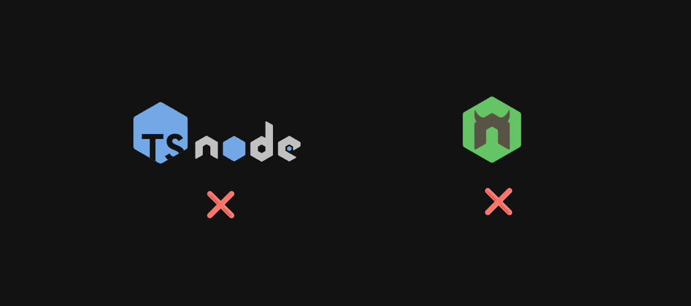

Starting from node `22.6.0`,
you can directly start writing on the `.ts` file without installing any dependencies:

`index.ts`

```typescript
function main(message: string): void {
  console.log("Message: " + message);
}
main("Hello! world");
```

For running with watch mode:

`package.json`

```json
"dev": "node -w index.ts"
```

Recommended base tsconfig
`tsconfig.json`

```json
{
  "compilerOptions": {
    "target": "esnext",
    "module": "nodenext",
    "allowImportingTsExtensions": true,
    "rewriteRelativeImportExtensions": true,
    "verbatimModuleSyntax": true,
    "erasableSyntaxOnly": true
  }
}
```
