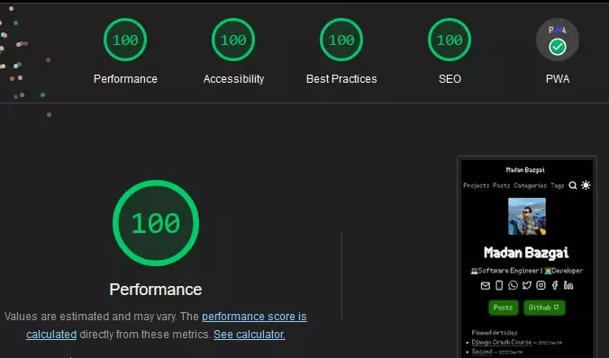

## 📄 About This Website

This is my **personal portfolio and blog application**, built to showcase my work, share articles, and experiment with modern web technologies.
It is powered by **[Astro](https://astro.build/)**, **Progressive Web App (PWA)** capabilities, and various performance-focused optimizations.

---

## 🚀 What is Astro?

- **Astro** is a modern web framework for content-driven websites like blogs and portfolios.
- It renders every page to plain HTML at build time and ships **zero JavaScript by default**, adding only the small scripts a page actually needs.
- Images are optimized automatically, code is highlighted at build time, and posts are plain **Markdown** files checked against a schema.

> This site was originally built with **Hugo** and later rewritten in Astro, keeping the same look while making it lighter and faster.

---

## 📱 What is a PWA?

- **PWA (Progressive Web App)** is a technology that enhances web applications with **native app-like capabilities**.
- PWAs can be installed on both **smartphones** and **desktops**.
- Every page of this site is cached for **offline access**, and new versions update automatically in the background.

---

## 📊 Performance & Lighthouse

- Static pages, optimized images, self-hosted fonts and very little JavaScript let the site aim for a **perfect 100% score** in Google Lighthouse for **Performance**, **Accessibility**, **Best Practices**, and **SEO**—under optimal conditions.
- Actual results may vary depending on the **browser**, **network** and installed **extensions**.

---

## 🎨 My Contributions

I designed, customized, and developed this application entirely from scratch.
It draws inspiration from the **Hugo PaperMod theme** and incorporates the **Nothing OS** font style.

Key features include:

- 🌗 **Dark/Light Mode**
- 📥 **Installable as an app**
- 📶 **Offline capability**
- 🔍 **Search functionality**
- 🖼️ **Automatically optimized images**
- 🔎 **SEO-friendly pages** with structured data and an RSS feed
- …and many more enhancements

---

## 📬 What You Can Do

- **Install** this app by clicking my **name** at the top of the page.
- Follow me on **GitHub** and other social platforms.
- Read and engage with articles, or subscribe via **[RSS](/blog/index.xml)**.
- Suggest improvements.

---

💚 **Thank you for visiting!** 💚
